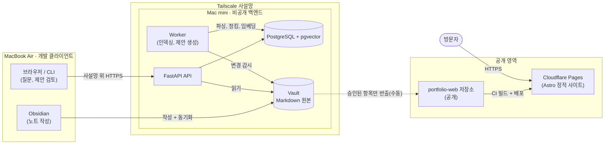

# Personal OS — Showcase

> **Personal OS**의 공개용 문서입니다. Personal OS는 Markdown 노트를 원본으로 두고, 그 위에 비공개 자체 호스팅 AI 백엔드(하이브리드 검색 + RAG)와 공개 포트폴리오 사이트를 얹은 개인 지식 시스템입니다.

[English](README.md) | 한국어

## 현재 상태

**Phase 1 — 스캐폴딩.** 이 저장소에는 현재 문서만 있습니다(코드, 데모, 측정값 없음). 아래 아키텍처는 설계이며, 구성요소는 비공개 저장소에서 구현 중입니다. [공개 정책](docs/disclosure-policy.md) 검토를 거친 내용만 이 저장소에 반영합니다.

## 아키텍처

- **클라이언트**는 노트를 작성하고, 사설망을 통해서만 백엔드와 통신합니다.
- **백엔드**(API, worker, 데이터베이스, Vault)는 공용 인터넷에서 들어오는 경로가 없습니다.
- **공개 사이트**는 정적 사이트이며, 별도로 검토된 콘텐츠로만 빌드되고, 백엔드를 호출하지 않습니다.

자세한 내용: [docs/architecture.md](docs/architecture.md) (영어).

## 설계 원칙

1. **Markdown이 원본입니다.** 노트는 평범한 파일이며, 중요한 것이 데이터베이스에만 존재하지 않습니다.
2. **DB와 인덱스는 파생물입니다.** PostgreSQL, 전문 검색 인덱스, 임베딩은 언제든 Markdown에서 삭제 후 재생성할 수 있습니다.
3. **공개와 비공개는 네트워크 수준에서 분리합니다.** 비공개 백엔드는 사설망으로만 접근할 수 있고, 공개 사이트는 백엔드로 되돌아가는 연결이 없는 정적 빌드입니다.
4. **승인 후, 별도 저장소로만 공개합니다.** 콘텐츠는 `publish_status: approved`와 allowlist 등록을 모두 만족할 때만 비공개 영역을 떠나며, 다른 저장소로 복사된 뒤 CI에서 다시 검증됩니다.
5. **글로벌 확장은 나중 기능이 아니라 기본 전제입니다.** 시간은 UTC / ISO 8601, 언어는 BCP 47 태그(기본 `ko`, `en` 활성), 노출성은 단일 공개/비공개 플래그가 아닌 독립된 축, 파일명은 ASCII kebab-case, 금액은 USD와 측정일로 표기합니다.

## 저장소

| 저장소 | 공개 여부 | 역할 | 링크 |
|---|---|---|---|
| `personal-os-showcase` | 공개 | 이 저장소: 민감정보를 제거한 아키텍처, 설계 결정, 벤치마크 | `https://github.com/<owner>/personal-os-showcase` (플레이스홀더) |
| `portfolio-web` | 공개 | Astro 기반 포트폴리오 및 기술 블로그(ko/en), Cloudflare Pages 배포 | `https://github.com/<owner>/portfolio-web` (플레이스홀더) |
| `personal-os` | 비공개 | FastAPI 백엔드, worker, 인프라, 설계 문서 | 비공개 |
| `personal-vault` | 로컬 전용 | Obsidian Vault (Markdown 원본) | 비공개 |

## 문서

| 문서 | 내용 |
|---|---|
| [docs/architecture.md](docs/architecture.md) | 구성요소, 데이터 흐름, 통신·보안, 하이브리드 검색, 최소 데이터 모델 |
| [docs/disclosure-policy.md](docs/disclosure-policy.md) | 노출성 축, 이 저장소에 올릴 수 있는 것/없는 것, 공개 전 체크리스트 |
| [docs/decisions/README.md](docs/decisions/README.md) | 비공개 ADR을 공개판으로 복사하는 규칙 |
| [docs/benchmarks/README.md](docs/benchmarks/README.md) | 측정 항목 정의와 보고 형식(아직 수치 없음) |
| [AGENTS.md](AGENTS.md) | 이 저장소에서 작업하는 기여자·코딩 에이전트를 위한 규칙 |

`docs/` 아래 문서는 영어로 작성합니다. README만 영어(`README.md`)와 한국어(`README.ko.md`)를 함께 유지합니다.

## 라이선스

**미정.** 아직 `LICENSE` 파일이 없으며, 첫 공개 릴리스 전에 추가할 예정입니다. 공개 문서의 기본 라이선스로는 CC-BY-4.0을 계획하고 있습니다.
