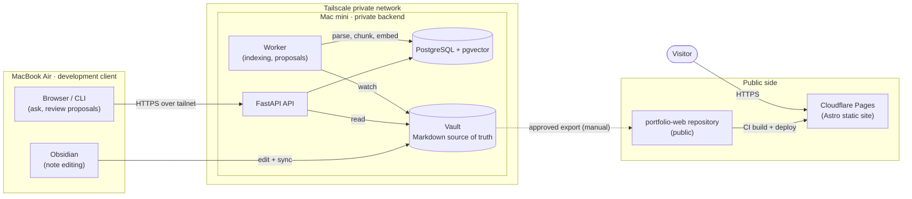

# Personal OS — Showcase

> Public documentation for **Personal OS**: a personal knowledge system where Markdown notes stay the source of truth, with a private self-hosted AI backend (hybrid search + RAG) and a public portfolio site built on top of them.

English | [한국어](README.ko.md)

## Status

**Phase 1 — scaffolding.** This repository currently contains documentation only (no code, no demo, no measurements). The architecture below is a design; components are being built in the private repositories and will be reflected here only after review under the [disclosure policy](docs/disclosure-policy.md).

## Architecture

- The **client** edits notes and talks to the backend only through the private network.
- The **backend** (API, worker, database, vault) has no inbound path from the public internet.
- The **public site** is static, built from separately reviewed content, and never calls the backend.

Details: [docs/architecture.md](docs/architecture.md).

## Design principles

1. **Markdown is the source of truth.** Notes are plain files; nothing important lives only in a database.
2. **The database and indexes are derived.** PostgreSQL, full-text indexes and embeddings can be dropped and rebuilt from the Markdown at any time.
3. **Public and private are separated at the network level.** The private backend is reachable only over a private network; the public site is a static build with no connection back to it.
4. **Publish only after approval, and only through a separate repository.** Content leaves the private side only with `publish_status: approved` plus an allowlist entry, and is copied into a different repository that is validated again by CI.
5. **Globalization is a baseline, not a later feature.** Time is UTC / ISO 8601, languages are BCP 47 tags (`ko` default, `en` enabled), exposure is a set of independent axes rather than one public/private flag, file names are ASCII kebab-case, and money is reported in USD with a measurement date.

## Repositories

| Repository | Visibility | Role | Link |
|---|---|---|---|
| `personal-os-showcase` | Public | This repository: sanitized architecture, decisions, benchmarks | `https://github.com/<owner>/personal-os-showcase` (placeholder) |
| `portfolio-web` | Public | Astro portfolio and technical blog (ko/en) on Cloudflare Pages | `https://github.com/<owner>/portfolio-web` (placeholder) |
| `personal-os` | Private | FastAPI backend, worker, infrastructure, design documents | Not public |
| `personal-vault` | Local only | Obsidian vault (the Markdown source of truth) | Not public |

## Documentation

| Document | Contents |
|---|---|
| [docs/architecture.md](docs/architecture.md) | Components, data flows, communication and security, hybrid search, minimum data model |
| [docs/disclosure-policy.md](docs/disclosure-policy.md) | Exposure axes, what may and may not be published here, pre-publication checklist |
| [docs/decisions/README.md](docs/decisions/README.md) | Rules for copying private ADRs into public form |
| [docs/benchmarks/README.md](docs/benchmarks/README.md) | Metric definitions and reporting format (no numbers yet) |
| [AGENTS.md](AGENTS.md) | Rules for contributors and coding agents working in this repository |

## License

**To be decided.** No `LICENSE` file has been added yet; one will be added before the first public release. The planned default for public documentation is CC-BY-4.0.
