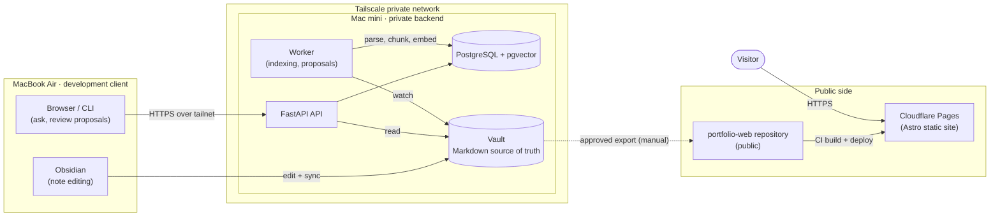
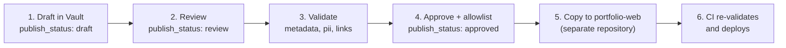
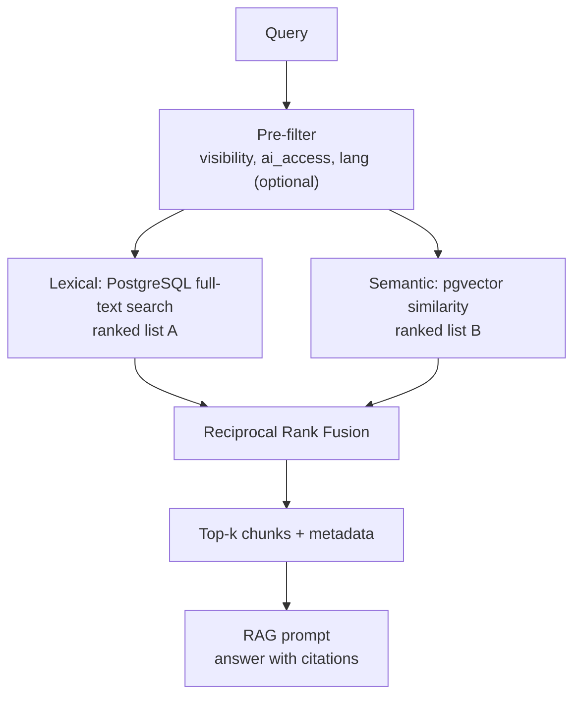

# Architecture (public edition)

Sanitized architecture of Personal OS. Hostnames, paths, credentials, and personal content are intentionally absent; see the [disclosure policy](disclosure-policy.md).

> **Status: design, Phase 1 (scaffolding).** Everything below describes the intended system. Nothing here is a measurement; metrics are defined in [benchmarks](benchmarks/README.md) and have no values yet.

## 1. Overview

Personal OS keeps personal knowledge as Markdown notes (the **Vault**) and adds three layers on top:

1. A **private backend** that indexes the Vault, answers questions with hybrid search and RAG, and proposes (never silently applies) organization changes.
2. A **private network** (Tailscale) that is the only way to reach the backend.
3. A **public site** that is a static build of separately reviewed content.

## 2. Components

| Component | Where | Responsibility |
|---|---|---|
| Vault | Backend host (synced from client) | Markdown notes with YAML frontmatter. The source of truth. |
| Obsidian | Client | Authoring and browsing notes. |
| Browser / CLI client | Client | Asking questions, reviewing agent proposals. |
| API (FastAPI) | Backend host | Search, question answering, proposal review. Stateless; reads the Vault and the database. |
| Worker | Backend host | Watches the Vault; parses, chunks, embeds; maintains the index; generates organization proposals. |
| PostgreSQL + pgvector | Backend host | Derived data only: document metadata, chunks, full-text and vector indexes, jobs, chat history, proposals. Rebuildable from the Vault (except chat history and proposal decisions, which are application data). |
| Tailscale | Client and backend host | Private network; the only route to the API and to administration. |
| Public site (Astro) | Cloudflare Pages | Static portfolio and technical blog, Korean and English. |
| `portfolio-web` repository | GitHub (public) | Reviewed content and site source; CI validates and deploys. |

## 3. Data flows

| Flow | Trigger | Path | Result | Exposure notes |
|---|---|---|---|---|
| **Note authoring** | User edits a note | Obsidian → Vault → sync to backend → worker detects change → parse frontmatter, chunk, embed → write `documents`, `chunks`, `index_jobs` | Note is searchable | Markdown stays authoritative; the index can be rebuilt from it. Exposure columns are copied from frontmatter. |
| **AI question** | User asks a question | Client → API (tailnet) → retrieval ([hybrid search](#5-hybrid-search)) filtered by `visibility` and `ai_access` → prompt with retrieved chunks → model → answer with citations → `chat_sessions` / `chat_messages` | Answer citing source chunks | `ai_access: none` content is never retrieved; `local-only` content never leaves the backend host; only `cloud-allowed` content may reach an external model API. |
| **Automatic organization proposal** | Schedule or new Inbox note | Worker reads notes → generates a proposal (classification, related-note links, weekly review draft) → `agent_proposals` with status `pending` → user reviews in client → on approval the change is applied to the Vault as a normal Markdown edit | Reviewed, reversible change | Nothing is written to the Vault without explicit approval. Rejected proposals are kept for audit. |
| **Blog publication** | Author sets a note to `review` | Six-step pipeline, see [below](#4-publication-pipeline) | Static page on the public site | Requires `publish_status: approved` **and** allowlist entry; content is copied to a separate public repository and re-validated by CI. |
| **Visitor view** | Visitor opens the public site | Browser → Cloudflare Pages (CDN) → static HTML | Page rendered | No backend call. Only content that passed publication is present. |
| **Monitoring** | Continuous | Health endpoint, job and queue status, resource metrics → viewed over the tailnet | Operator sees failures and index lag | No public monitoring endpoint. Logs must not contain note content. |

## 4. Publication pipeline

The Vault never connects to the public site directly. Step 5 is the only point where content crosses from private to public, and it is a deliberate, reviewed copy. See [disclosure policy](disclosure-policy.md) for the axes and checklist.

## 5. Hybrid search

Retrieval combines lexical and semantic ranking so that exact terms (names, error messages, identifiers) and paraphrased meaning both work.

- **Lexical (FTS).** PostgreSQL `tsvector` over chunk text. The text-search configuration is chosen per `lang`; the default is `simple`, and Korean/English tokenization is a Phase 3 decision.
- **Semantic (pgvector).** One embedding per chunk from a multilingual embedding model; nearest neighbours by vector distance. The vector dimension follows the embedding model and is recorded with the indexing job.
- **Fusion (RRF).** Each ranked list contributes `1 / (k + rank)` per chunk and the contributions are summed; `k` is a smoothing constant (60 is the commonly used starting point, to be tuned against the benchmark set). RRF needs no score normalization between the two lists.
- **Filtering first.** Exposure filters are applied before ranking, not after, so restricted content can never leak into a prompt through a ranking tie.
- **Citations.** Answers reference chunk identifiers from the retrieved set; the [wrong-source citation rate](benchmarks/README.md) measures how often that fails.

## 6. Communication and security

| Segment | Method | Reachable from outside? |
|---|---|---|
| Client → API | HTTPS over the Tailscale network (WireGuard-encrypted) | No — tailnet members only |
| Client → backend administration | SSH or equivalent over the tailnet | No |
| Vault sync (client ↔ backend) | Sync mechanism still under evaluation (hosted sync with a headless client, peer-to-peer sync, or Git); runs only between the owner's own devices | No inbound path from the internet to the backend |
| API / worker → PostgreSQL | Local connection on the backend host; database port not published to the network | No |
| API / worker → external model or embedding API | Outbound HTTPS only, only for content with `ai_access: cloud-allowed` | Outbound only |
| Backend → public site | No direct connection; reviewed content is copied into a separate public repository | No |
| Repository → Cloudflare Pages | Git-integrated build and deploy | Public, static content only |
| Visitor → public site | HTTPS to Cloudflare Pages | Yes — static content only |
| Monitoring | Over the tailnet | No |

Security checklist (design intent):

- [ ] No port forwarding or public inbound rule to the backend host.
- [ ] Tailnet access control follows least privilege (client devices → API only).
- [ ] The database is not reachable from outside the backend host.
- [ ] Secrets live in environment configuration or a secret store; never in a repository.
- [ ] Exposure filters (`visibility`, `ai_access`) are enforced in the query layer, not only in the UI.
- [ ] The public site is built only from approved, allowlisted, re-validated content.
- [ ] Logs and error messages exclude note content and credentials.
- [ ] External model calls are limited to `ai_access: cloud-allowed` content, and each call's provider and model are recorded.

## 7. Minimum data model

Proposed schema for Phase 3; names and types may change. Conventions:

- All timestamps are `timestamptz`, stored in UTC; the database server time zone is UTC. Local time zones are applied only when displaying.
- `lang` is a BCP 47 tag (`ko`, `en`).
- Exposure columns use the axes defined in the [disclosure policy](disclosure-policy.md) with the most conservative defaults.
- Identifiers are UUIDs. Enumerations are `text` with check constraints (final choice deferred to a decision record).

### `documents`

| Column | Type | Notes |
|---|---|---|
| `id` | uuid | Primary key |
| `path` | text | Vault-relative path; unique |
| `title` | text | Original-language title |
| `type` | text | Note type from frontmatter |
| `lang` | text | BCP 47 tag |
| `translation_of` | uuid, nullable | References `documents.id` for translations |
| `content_hash` | text | Change detection |
| `frontmatter` | jsonb | Parsed frontmatter, verbatim |
| `visibility` | text | `private` \| `restricted` \| `public`; default `private` |
| `audience` | text[] | Default `{self}` |
| `publish_status` | text | `draft` \| `review` \| `approved` \| `published` \| `retracted`; default `draft` |
| `publish_targets` | text[] | Default empty |
| `ai_access` | text | `none` \| `local-only` \| `cloud-allowed`; default `local-only` |
| `pii` | boolean | Default `false` |
| `license` | text, nullable | SPDX identifier |
| `created_at` | timestamptz | From frontmatter, normalized to UTC |
| `updated_at` | timestamptz | From frontmatter, normalized to UTC |
| `indexed_at` | timestamptz, nullable | Last successful indexing |

### `chunks`

| Column | Type | Notes |
|---|---|---|
| `id` | uuid | Primary key |
| `document_id` | uuid | References `documents.id`; cascade delete |
| `ordinal` | integer | Position within the document |
| `heading_path` | text | Heading trail, used for citations |
| `content` | text | Chunk text |
| `lang` | text | BCP 47 tag; normally inherited from the document |
| `visibility` | text | Copied from the document so retrieval filters need no join |
| `ai_access` | text | Copied from the document, same reason |
| `fts` | tsvector | Full-text search vector |
| `embedding` | vector | Dimension follows the embedding model |
| `content_hash` | text | Skip re-embedding unchanged chunks |
| `created_at` | timestamptz | |

The copied exposure columns are refreshed whenever the parent document changes, in the same transaction.

### `index_jobs`

| Column | Type | Notes |
|---|---|---|
| `id` | uuid | Primary key |
| `document_id` | uuid, nullable | Null for corpus-wide jobs |
| `job_type` | text | For example `index`, `reindex`, `delete` |
| `status` | text | `queued` \| `running` \| `succeeded` \| `failed` |
| `attempts` | integer | Retry count |
| `embedding_model` | text, nullable | Model identifier used |
| `last_error` | text, nullable | Sanitized; never contains note content |
| `queued_at` | timestamptz | |
| `started_at` | timestamptz, nullable | |
| `finished_at` | timestamptz, nullable | |

### `chat_sessions`

| Column | Type | Notes |
|---|---|---|
| `id` | uuid | Primary key |
| `title` | text, nullable | |
| `lang` | text | BCP 47 tag of the conversation |
| `visibility` | text | Default `private`; chat history is never published |
| `ai_access` | text | Ceiling for what this session may send to a model; default `local-only` |
| `created_at` | timestamptz | |
| `updated_at` | timestamptz | |
| `archived_at` | timestamptz, nullable | |

### `chat_messages`

| Column | Type | Notes |
|---|---|---|
| `id` | uuid | Primary key |
| `session_id` | uuid | References `chat_sessions.id` |
| `role` | text | `user` \| `assistant` \| `system` \| `tool` |
| `content` | text | Message text |
| `lang` | text | BCP 47 tag |
| `pii` | boolean | Default `false` |
| `citations` | jsonb, nullable | Chunk identifiers used for the answer |
| `model` | text, nullable | Model identifier for assistant messages |
| `input_tokens` / `output_tokens` | integer, nullable | For cost accounting |
| `cost_usd` | numeric, nullable | USD only; pricing date recorded with the benchmark, not per row |
| `created_at` | timestamptz | |

### `agent_proposals`

| Column | Type | Notes |
|---|---|---|
| `id` | uuid | Primary key |
| `kind` | text | For example `classify`, `link`, `metadata_fix`, `weekly_review` |
| `document_id` | uuid, nullable | Target document |
| `payload` | jsonb | The proposed change (for example a diff) |
| `rationale` | text | Why the agent proposed it |
| `lang` | text | BCP 47 tag of the proposal text |
| `visibility` | text | Default `private`; proposals are never published |
| `ai_access_used` | text | The `ai_access` level the model call was allowed to use |
| `model` | text, nullable | |
| `status` | text | `pending` \| `approved` \| `rejected` \| `applied` \| `expired` |
| `created_at` | timestamptz | |
| `decided_at` | timestamptz, nullable | |
| `applied_at` | timestamptz, nullable | |

## 8. What is not covered here

Implementation details, real network layout, credentials, deployment specifics, and private design documents. Public versions of design decisions are listed under [decisions](decisions/README.md).
